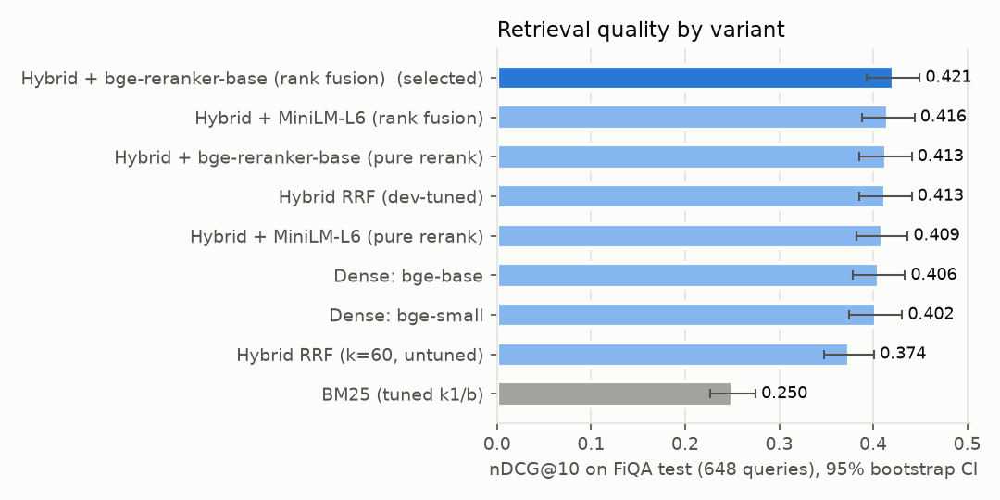
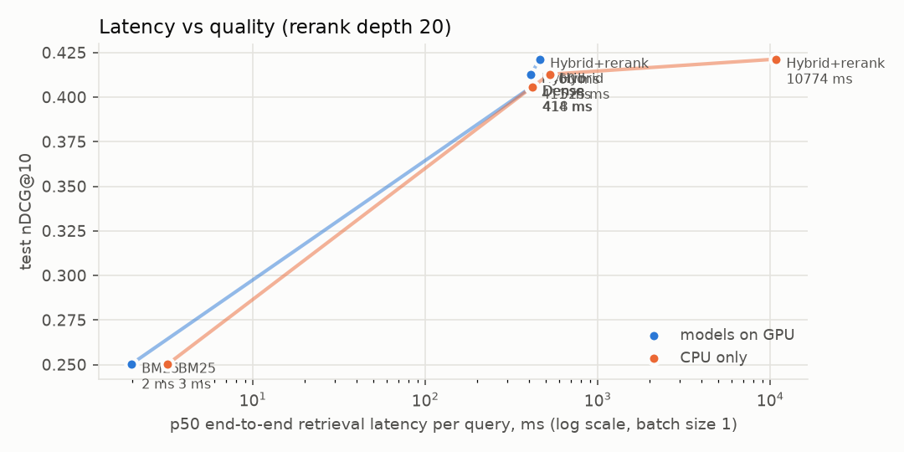
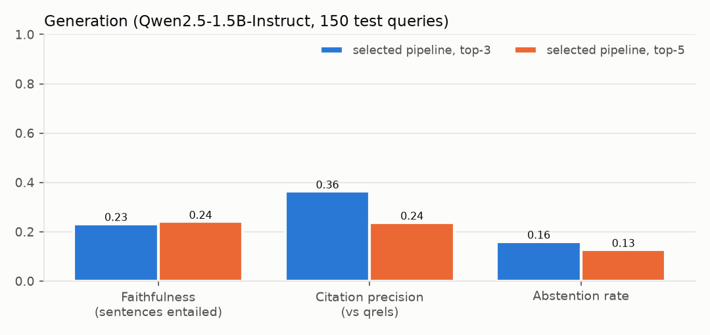

# finrag-eval

Hybrid retrieval-augmented generation over financial Q&A (BEIR FiQA-2018), with an evaluation
harness that measures each stage separately: retrieval quality with bootstrap confidence intervals,
per-stage latency, and whether generated answers cite real passages, cite relevant ones, and say only
what those passages support. It runs on one laptop, with no API keys, servers or paid services.

## Problem

A RAG demo that "looks right" says little. The questions that matter are:

1. Does the retriever beat a properly tuned lexical baseline? By how much, and with what uncertainty?
2. Do the usual add-ons (hybrid fusion, cross-encoder reranking) actually help on this corpus?
3. When the generator cites `[docID]`, does that id exist, is the passage relevant, and does the
   passage entail the sentence it is attached to?
4. Does the model abstain when the context cannot answer?

Every choice is tuned on the 500 FiQA dev queries; the 648 test queries are scored once with the
frozen choices. Every number below is read from a file in `reports/`.

## Architecture

```
 FiQA-2018: 57,638 passages, 6,648 queries (train 5,500 / dev 500 / test 648)
        | clean_text: HTML unescape, tag strip, zero-width removal, NFKC, whitespace
        +------------------------------+-------------------------------+
        v                              v                               |
  bm25s (Lucene BM25)          bge-base-en-v1.5, fp16, 768-d            |
  Snowball stem + stopwords    -> Qdrant (embedded, cosine, exact)      |
  k1=0.9 b=0.75 (dev grid)     (bge-small also built and compared)      |
        | top-100                      | top-100                       |
        +-------> weighted RRF <-------+   k=5, dense weight 3.0 (dev)  |
                      | top-20                                         |
         bge-reranker-base cross-encoder, rank-fused with the          |
         first-stage order (RRF k=5, CE weight 0.5; selected on dev)   |
                      | top-k context (3 or 5 passages)                |
         Qwen2.5-1.5B-Instruct (local, fp16, greedy) behind a          |
         Generator protocol: answer with [docID] after each sentence,  |
         or exactly "not enough information"                           |
                      |                                                |
   eval: citation validity | citation precision vs qrels | NLI faithfulness (DeBERTa-v3) | abstention
                      |
     FastAPI  /search  /answer  /health   <---   Streamlit UI (calls the API over HTTP)
```

Code: `src/finrag/` (one CLI entrypoint, `finrag`), experiments in `src/finrag/experiments/`,
UI in `app/streamlit_app.py`, tests in `tests/` (they run on CPU with fakes, no model downloads).

## Results (test split, 648 queries, scored once)

### Retrieval

| Variant | nDCG@10 [95% CI] | Recall@10 | Recall@100 | MRR@10 |
|---|---|---|---|---|
| BM25 (bm25s, dev-tuned k1/b) **baseline** | 0.2502 [0.226, 0.275] | 0.3131 | 0.5494 | 0.3106 |
| Dense bge-small-en-v1.5 | 0.4024 [0.374, 0.431] | 0.4631 | 0.6945 | 0.4864 |
| Dense bge-base-en-v1.5 | 0.4058 [0.378, 0.434] | 0.4819 | 0.7404 | 0.4844 |
| Hybrid, untuned RRF (k=60, equal weights) | 0.3743 [0.348, 0.401] | 0.4581 | 0.7144 | 0.4512 |
| Hybrid, dev-tuned RRF (k=5, dense weight 3) | 0.4128 [0.386, 0.441] | 0.4967 | 0.7424 | 0.4873 |
| + pure rerank, MiniLM-L6 CE | 0.4094 [0.383, 0.437] | 0.4967 | 0.7424 | 0.4829 |
| + CE rank fusion, MiniLM-L6 | 0.4158 [0.388, 0.444] | 0.4991 | 0.7424 | 0.4914 |
| + pure rerank, bge-reranker-base | 0.4133 [0.385, 0.441] | 0.4967 | 0.7424 | 0.4869 |
| + CE rank fusion, bge-reranker-base **(selected)** | 0.4213 [0.394, 0.449] | 0.5014 | 0.7424 | 0.4978 |

Source: `reports/retrieval_test.json` (`variants`). CIs are percentile bootstraps over queries
(10k draws). The metrics are this repo's own implementation (`finrag.metrics`, unit-tested). They
were cross-checked against `ir_measures`/pytrec_eval on every variant, with a max absolute difference
of 4.4e-16 across all 9 variants (`variants.*.crosscheck.max_abs_diff`).

Paired bootstrap on per-query nDCG@10 (`paired_bootstrap_ndcg@10`):

| Comparison | diff [95% CI] | p | relative |
|---|---|---|---|
| selected pipeline vs BM25 | +0.1711 [+0.1512, +0.1920] | 0.0001 | +68.4% |
| dense bge-base vs BM25 | +0.1556 [+0.1337, +0.1784] | 0.0001 | +62.2% |
| tuned hybrid vs dense | +0.0069 [+0.0014, +0.0128] | 0.0150 | +1.7% |
| untuned RRF (k=60) vs dense | -0.0316 [-0.0489, -0.0147] | 0.0005 | -7.8% |
| selected (CE rank fusion) vs tuned hybrid | +0.0086 [+0.0022, +0.0152] | 0.0123 | +2.1% |
| pure CE rerank (bge) vs tuned hybrid | +0.0005 [-0.0092, +0.0102] | 0.9173 | +0.1% |

What the table says:
- Almost all of the gain over BM25 comes from the dense encoder.
- Plain RRF with the textbook k=60 and equal weights is *worse* than dense alone. BM25 is so much
  weaker here that equal weighting drags good dense results down. Only after dev tuning (k=5, dense
  weight 3) does the hybrid beat dense.
- Pure cross-encoder reranking adds nothing measurable (it was below the hybrid on dev at every depth
  from 5 to 50). Fusing the CE order with the first-stage order, rather than replacing it, gives a small
  but significant +0.0086.



### Latency (batch size 1, single query, i7-11800H with 4 threads; RTX 3060 Laptop for models)

| Mode | models on | n | total p50 / p95 (ms) | main stages p50 (ms) |
|---|---|---|---|---|
| bm25 | cuda | 200 | 2.0 / 2.5 | bm25 1.6 |
| dense | cuda | 200 | 413.8 / 563.9 | embed_query 21.7, dense_search 391.4 |
| hybrid | cuda | 200 | 410.6 / 529.9 | bm25 2.8, embed_query 20.4, dense_search 385.2 |
| hybrid_rerank | cuda | 200 | 459.9 / 506.1 | bm25 2.6, embed_query 18.4, dense_search 292.5, rerank 147.1 |
| bm25 | cpu | 100 | 3.2 / 5.5 | bm25 2.5 |
| dense | cpu | 100 | 417.9 / 621.4 | embed_query 70.9, dense_search 348.4 |
| hybrid | cpu | 100 | 525.4 / 600.7 | bm25 3.0, embed_query 80.6, dense_search 441.1 |
| hybrid_rerank | cpu | 30 | 10774.4 / 12101.0 | dense_search 306.9, rerank 10391.8 |

Source: `reports/latency.json` (`cuda.modes`, `cpu.modes`). The dense search stage dominates, and
that cost belongs to Qdrant's embedded (pure Python) mode, not to the method. A NumPy exact top-100
search over the same 57,638 vectors takes 10.7 ms p50 and agrees with Qdrant on 99.66% of top-100 ids
(`numpy_exact_dense_reference`). With a Qdrant server or an in-process matrix search, the GPU hybrid
+ rerank path would be about 180 ms (the other measured stage p50s plus the NumPy search). That is
an estimate, not an end-to-end measurement. On CPU only, the reranker costs about 10 s per query, so a CPU deployment
should serve the tuned hybrid without reranking (0.4128 vs 0.4213 nDCG@10).



### Generation (150 sampled test queries, Qwen2.5-1.5B-Instruct, greedy, prompt v1)

The same 150 test queries (seed 13) were answered with the top-3 and the top-5 passages of the
selected retrieval pipeline, then judged by DeBERTa-v3 NLI against the passages.

| Metric | top-3 context | top-5 context |
|---|---|---|
| Answered (not abstained) | 126 / 150 | 131 / 150 |
| Answers that cite at least one `[docID]` | 0.381 | 0.389 |
| Citation validity (cited id was in the prompt) | 0.975 | 0.970 |
| Citation precision vs qrels | 0.364 | 0.237 |
| ... reference: share of context passages judged relevant | 0.247 | 0.184 |
| Sentence faithfulness (entailed by its cited passage) | 0.232 | 0.241 |
| Sentences entailed by *any* context passage | 0.764 | 0.791 |
| Abstention rate | 0.160 | 0.127 |
| ... when a judged-relevant passage was in context / when none was | 0.148 / 0.174 | 0.122 / 0.133 |
| Throughput, batch 8 (s per answer) | 1.32 | 1.81 |

Source: `reports/generation_eval.json` (`configs.*`) and `reports/generation_runs_test.json`
(`timing`). Metric definitions are in the `finrag/faithfulness.py` docstring. Top-5 vs top-3 is not
significant on answer-level faithfulness (paired bootstrap diff +0.0004, p=0.99, `paired_bootstrap`).
Single-query `/answer` generation latency (batch 1, top-5) was 6.95 s p50 over only 5 queries. Peak
VRAM was 4.15 GB.

What the outputs show (counts are for top-5; details are in `INTERVIEW_NOTES.md`):
- **When the model cites, the ids are real.** 97% of cited ids were in the prompt. The rest are
  mostly the prompt's example id `[doc12345]` copied into 3 answers.
- **The main failure is missing citations, not invented content.** 80 of 131 answers cite nothing.
  Yet 76% of the uncited sentences are entailed by some context passage. The 0.24 vs 0.79 gap between
  the two faithfulness rows is mostly a citation-format problem in a 1.5B model.
- **Citations pick relevant passages better than chance.** Citation precision is 0.364 against a
  0.247 base rate (top-3). More context lowers it (0.237), and wrong-passage citations rise from 3 to
  20 sentences.
- **Abstention does not track answerability.** The rate is nearly the same whether or not a
  judged-relevant passage was in context.



Prompt selection (dev, 24 queries): a few-shot variant (v2) cut the share of answers with a citation
from 45% to 17% versus the instruction prompt (v1), so v1 was frozen before the test run
(`reports/generation_eval_dev_prompt_v1.json`, `..._v2.json`). A third config, BM25 top-5 context,
was run on dev only, to stay within the GPU budget. So the effect of retrieval quality on generation
is not measured on test.

## Reproduce

```bash
uv sync --extra ml --extra ui          # Python 3.12; torch from the CUDA 12.8 index on Windows
uv run finrag all                      # data -> indexes -> dev tuning -> test eval -> generation eval -> figures
uv run pytest -q                       # 44 tests, CPU only, about 10 s (1.4 s of test time)
```

`finrag all` runs the stages listed in `scripts/reproduce.sh`, which can also be run one stage at a
time, with the GPU stages wrapped in a lock. Data and models go to `$FINRAG_DATA_DIR` /
`$FINRAG_MODELS_DIR`. Development used about 74 GPU-minutes on an RTX 3060 Laptop, including discarded
reruns, so a clean pass needs less.

Serve:

```bash
FINRAG_DEVICE=cuda uv run uvicorn finrag.api:create_default_app --factory --port 8000
uv run streamlit run app/streamlit_app.py      # talks to FINRAG_API_URL (default http://127.0.0.1:8000)
```

`FINRAG_GENERATOR=0` starts the API with search only (no LLM loaded).

## Data and model sources and licenses

| Asset | Source (pinned revision) | License |
|---|---|---|
| FiQA-2018 corpus + queries | https://huggingface.co/datasets/BeIR/fiqa @ `979c07a7cb5c` | CC BY-SA 4.0 |
| FiQA-2018 qrels | https://huggingface.co/datasets/BeIR/fiqa-qrels @ `252958f2d646` | CC BY-SA 4.0 |
| bge-small-en-v1.5 | https://huggingface.co/BAAI/bge-small-en-v1.5 @ `5c38ec7c405e` | MIT |
| bge-base-en-v1.5 | https://huggingface.co/BAAI/bge-base-en-v1.5 @ `a5beb1e3e68b` | MIT |
| ms-marco-MiniLM-L6-v2 | https://huggingface.co/cross-encoder/ms-marco-MiniLM-L6-v2 @ `233902d25c44` | Apache-2.0 |
| bge-reranker-base | https://huggingface.co/BAAI/bge-reranker-base @ `2cfc18c9415c` | MIT |
| Qwen2.5-1.5B-Instruct | https://huggingface.co/Qwen/Qwen2.5-1.5B-Instruct @ `989aa7980e4c` | Apache-2.0 |
| DeBERTa-v3-base-mnli-fever-anli | https://huggingface.co/MoritzLaurer/DeBERTa-v3-base-mnli-fever-anli @ `6f5cf0a2b59c` | MIT |

Full commit hashes are in `src/finrag/config.py` (`MODEL_REVISIONS`) and `reports/data_stats.json`.
No data or weights are committed. Code: MIT (see `LICENSE`).

## Limitations

- **Sparse qrels.** FiQA has about 2.6 judged-relevant passages per test query, and unjudged passages
  count as non-relevant. So retrieval metrics and "citation precision vs qrels" are lower bounds:
  a cited passage that answers the question but was never judged counts as a miss.
- **Embedded Qdrant is exact and slow.** This is fine at 57.6K vectors for evaluation, but it is not
  how this would be served. HNSW was configured but not exercised (embedded mode ignores it), so no
  ANN recall/latency trade-off is measured here.
- **Reranking gain is small** (+0.0086 nDCG@10, CI [0.0022, 0.0152]). On CPU it is not worth its
  latency.
- **Small generator.** A 1.5B model follows the citation format inconsistently: 61% of top-5 answers
  cite nothing. Generation is evaluated on 150 sampled test queries, with one seed and greedy decoding.
  The prompt was chosen from two variants on only 24 dev queries. Retrieval quality (BM25 vs selected
  context) was compared for generation on dev only.
- **Windows GPU memory.** With the NVIDIA driver's sysmem fallback, PyTorch's cache spilled into host
  RAM during batched generation (over 5 GB RSS, about 2x slower). Two changes fixed it: loading with
  `device_map`, and capping the VRAM fraction and clearing the cache per batch. The run after the fix
  peaked at 1.83 GB host RSS (`generation_runs_test.json`).
- **NLI as a faithfulness judge** is an approximation. The DeBERTa NLI model sees at most 512 tokens,
  passages are truncated to 180 words in the prompt and the judge, and paraphrase-heavy or numeric
  claims can be misjudged in either direction. No human agreement study was done.
- **Shared laptop GPU.** Latency was measured on a laptop whose GPU was shared with another workload
  (serialised by a lock, but thermals were not controlled). p95 values are the least reliable numbers.
- **Serving only smoke-tested.** `/health`, `/search` (hybrid and hybrid_rerank) and the 503 from
  `/answer` without a generator were checked against the real indexes on CPU. `/answer` with the LLM
  loaded and the Streamlit UI were not run end to end; API behaviour is covered by fake-backed tests.
- **CI passes on GitHub.** `.github/workflows/ci.yml` (ruff + pytest on CPU, no model downloads) passed
  on its first run ([run 42404125349](https://github.com/fahranalam04-cmd/finrag-eval/actions/runs/42404125349), 2026-11-07).
